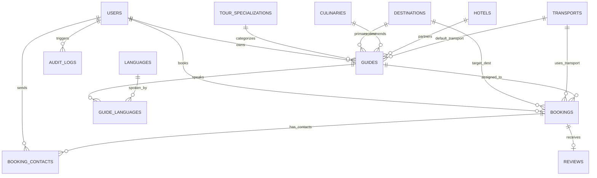

# SumutGO Tour Guides — Sistem Direktori, Booking & Integrasi Transportasi Sumatera Utara

Aplikasi web client-server berbasis **CodeIgniter 4.7 (PHP 8.2+)** dan **PostgreSQL 17 (Supabase)** dengan arsitektur RESTful API `/api/v1/...`, keamanan berlapis (JWT HS256, RBAC, Rate Limiting, Row Level Security PostgreSQL), pengendalian konkurensi (**Optimistic Locking** + **GiST Exclusion Constraint**), serta proxy aman ke layanan eksternal **Transport Application API** (`https://transport-aplication.wrldapp.xyz`).

---

## Ringkasan Arsitektur & Teknologi

| Lapisan | Teknologi & Implementasi |
| :--- | :--- |
| **Backend Framework** | CodeIgniter 4.7, PHP `^8.2`, `ApiResponseTrait`, `PgErrorMapper`, `DbTransactionRunner` |
| **Database Server** | PostgreSQL 17 (Supabase Transaction Pooler port `6543`, SSL `require`) |
| **Ekstensi PostgreSQL** | `btree_gist` (anti double-booking overlap tanggal) & `pg_trgm` (pencarian cepat GIN trigram) |
| **Autentikasi & Keamanan** | JWT HS256 (`JwtService`), Password `PASSWORD_BCRYPT`, RBAC (`JwtAuthFilter`, `RoleFilter`), `ApiRateLimitFilter`, CORS, dan **RLS aktif di seluruh 13 tabel** |
| **Konkurensi & ACID** | `SELECT ... FOR UPDATE`, Exclusion Constraint `ex_bookings_guide_no_overlap` (`23P01`), Optimistic Locking `version` (`40001`), serta `BEGIN ... SET LOCAL ROLE ... COMMIT/ROLLBACK` |
| **Frontend Web** | TailwindCSS, Leaflet.js 1.9.4 (peta interaktif + simulasi rute), Chart.js 4.4.1, Vanilla JS (`api.js`, `auth.js`, `app.js`) |
| **Integrasi Eksternal** | Server-side proxy `TransportProxyController` + `TransportApiClient` ke `https://transport-aplication.wrldapp.xyz` (`X-API-KEY` disimpan aman di server) |

---

## Fitur Utama Aplikasi

### 1. Portal Wisatawan (`/`)
- **Beranda & Direktori 150 Pemandu**: Filter multi-kriteria (status ketersediaan, spesialisasi, destinasi, bahasa, rentang tarif, rating), sorting, pencarian teks cepat, mode favorit, dan detail pemandu.
- **Blur Gate & Role Dinamis**: Registrasi publik otomatis menetapkan role `wisatawan` tanpa pilihan role di form; detail kontak pemandu terkunci dengan efek blur sebelum login dan terbuka setelah autentikasi.
- **Booking Multi-Hari & Konfirmasi**: Mendukung pemesanan rentang tanggal mulai–selesai; `duration_days` dan `total_price_idr` dihitung otomatis oleh kolom `GENERATED ALWAYS STORED` di PostgreSQL. Dilengkapi ringkasan pra-kirim, bukti reservasi, serta fitur kontak komunikasi (`booking-contacts`).
- **Pembanding Pemandu (Max 3, Terisolasi per Akun)**: Dibatasi maksimal 3 pemandu per akun login (`4+` ditolak dan wajib menghapus salah satu terlebih dahulu).
- **Sinkronisasi Status & Tanggal Akhir Bertugas**: Menampilkan `active_booking_end_date` ("s.d. tanggal ...") ketika pemandu berstatus `Booked` atau `Sedang Bertugas`, tersinkronisasi otomatis saat booking dibuat, dimulai, selesai, atau dibatalkan.
- **Peta Basecamp (Leaflet.js) & Kalkulator Trip (Transport API Proxy)**: Visualisasi basecamp pemandu, simpul transportasi bandara/stasiun/terminal/pelabuhan, simulasi tarif antar titik simpul, dan rekomendasi rute transportasi ke destinasi wisata.

### 2. Portal Admin & API Sandbox (`/admin`)
- KPI ringkasan status pemandu secara real-time (`Tersedia`, `Sedang Bertugas`, `Booked`).
- Verifikasi akun pendaftar & nomor HP (`PATCH /api/v1/users/{id}/verify`).
- Konfirmasi kontak komunikasi pemesan ↔ pemandu (`PATCH /api/v1/booking-contacts/{id}/confirm`).
- Manajemen siklus status reservasi (`pending` → `confirmed` → `ongoing` → `completed` / `cancelled`) dengan Optimistic Locking.
- Pengelolaan master transportasi eksternal melalui proxy terproteksi Admin (`/api/v1/transport/admin/*`).

---

## Perancangan Database 3NF & ERD (K1)

Basis data dirancang memenuhi **3NF** dengan **13 tabel** di schema `public`:



### Objek Database Server (K2) & Pengendalian Konkurensi (K7)

| Objek Database | Nama Objek | Fungsi & Mekanisme |
| :--- | :--- | :--- |
| **Views** | `vw_guides_detail`, `vw_bookings_detail` | Menggabungkan tabel utama dengan master lookup, agregasi array/JSON bahasa (`ARRAY_AGG`, `JSONB_AGG`), ringkasan review internal, `active_booking_end_date`, serta informasi `booking_contacts` terkini (`LEFT JOIN LATERAL`). |
| **Stored Functions** | `fn_create_booking`, `fn_update_booking_status` | Didefinisikan sebagai `SECURITY DEFINER`: mengunci baris `guides`/`bookings` via `FOR UPDATE`, menghasilkan kode unik via `seq_booking_code`, memvalidasi transisi status, memeriksa Optimistic Locking `version`, dan menyinkronkan `guides.availability_status`. |
| **Triggers** | `trg_users_updated_at`, `trg_booking_contacts_updated_at`, `trg_bookings_audit_log`, `trg_guides_audit_log`, `trg_booking_contacts_audit_log`, `trg_users_verification_audit_log`, `trg_reviews_only_completed` | Mencatat jejak perubahan sebelum/sesudah (JSONB `old_data`/`new_data`) ke `audit_logs` serta memblokir input ulasan sebelum status booking mencapai `completed` (`P0001`). |
| **Constraints** | `ex_bookings_guide_no_overlap`, `GENERATED ALWAYS AS` | Mencegah jadwal pemandu bentrok secara paralel via `EXCLUDE USING gist (guide_id WITH =, daterange(start_date, end_date, '[]') WITH &&) WHERE (status NOT IN ('cancelled'))` (`23P01` → `409 Conflict`). |
| **Roles & RLS** | `role_sumutgo_admin`, `role_sumutgo_mobile` | Prinsip Least Privilege via `SET LOCAL ROLE`: `role_sumutgo_mobile` dilarang `DELETE`/`TRUNCATE` & diblokir mengakses `audit_logs`; seluruh 13 tabel mengaktifkan `ROW LEVEL SECURITY`. |

---

## Ringkasan Endpoint RESTful API v1 (`/api/v1`)

Seluruh respons memakai amplop JSON seragam dari `ApiResponseTrait`:

```json
{
  "status": "success | error",
  "message": "Pesan ringkas yang aman untuk client",
  "data": {},
  "meta": { "current_page": 1, "per_page": 15, "total_items": 150, "total_pages": 10 },
  "errors": null
}
```

| Kategori | Method & Endpoint | Autentikasi / Filter | Keterangan |
| :--- | :--- | :--- | :--- |
| **Auth** | `POST /api/v1/auth/register` | Rate Limit `15/60s` | Daftar akun wisatawan baru |
| | `POST /api/v1/auth/login` | Rate Limit `15/60s` | Login & terima JWT HS256 |
| | `GET /api/v1/auth/me`, `POST /api/v1/auth/logout` | `jwt` | Profil aktif & logout |
| **Master** | `GET /api/v1/master/all`, `/{resource}`, `/{resource}/{id}` | Publik | 6 tabel master (`specializations`, `languages`, `destinations`, `culinaries`, `hotels`, `transports`) |
| | `POST/PUT/DELETE /api/v1/master/{resource}...` | `jwt`, `role:admin` | Kelola master data |
| **Guides** | `GET /api/v1/guides`, `GET /api/v1/guides/{id_or_code}` | Publik | Katalog pemandu, filter, sort, & detail |
| | `POST /api/v1/guides`, `PUT/DELETE /api/v1/guides/{id}` | `jwt`, `role:admin` | CRUD pemandu + Optimistic Locking (`version`) |
| **Bookings** | `GET /api/v1/bookings`, `GET /api/v1/bookings/{id}` | `jwt` | Daftar & detail reservasi (scoped per role) |
| | `POST /api/v1/bookings` | `jwt`, `role:wisatawan,admin` | Buat reservasi ACID via `fn_create_booking` |
| | `PATCH /api/v1/bookings/{id}/status` | `jwt` | Update status booking via `fn_update_booking_status` |
| **Contacts** | `GET /api/v1/booking-contacts`, `POST /api/v1/booking-contacts` | `jwt` | Pesan & kontak komunikasi booking |
| | `PATCH /api/v1/booking-contacts/{id}/confirm` | `jwt`, `role:admin` | Konfirmasi status kontak booking |
| **Users** | `GET /api/v1/users`, `PATCH /api/v1/users/{id}/verify` | `jwt`, `role:admin` | Daftar user & verifikasi nomor HP |
| **Reviews** | `GET /api/v1/reviews`, `POST /api/v1/reviews` | Publik / `jwt` (`wisatawan`) | Ulasan booking `completed` |
| **Analytics** | `GET /api/v1/stats`, `GET /api/v1/audit-logs` | Publik / `jwt`, `role:admin` | Statistik ringkasan & audit log JSONB |
| **Transport** | `GET /api/v1/transport/status`, `/transports`, `/lokasi`, `/tarif`, `/master/{res}` | Publik / Rate Limit | Proxy baca layanan Transport API (`X-API-KEY` server-side) |
| | `GET\|POST /api/v1/transport/rekomendasi-wisata` | Rate Limit `60/60s` | Rekomendasi rute & tarif transportasi wisata |
| | `GET\|POST\|PUT\|PATCH\|DELETE /api/v1/transport/admin/{res}...` | `jwt`, `role:admin` | CRUD master transport eksternal (membutuhkan writable `TRANSPORT_API_SECRET_KEY`) |

> Koleksi Postman lengkap tersedia di [docs/postman_collection_v1.json](docs/postman_collection_v1.json).

---

## Panduan Instalasi & Konfigurasi Lokal

### 1. Prasyarat
- PHP `8.2+` dengan ekstensi `pgsql`, `curl`, `intl`, `mbstring`, `json`.
- Composer & akses database PostgreSQL 16/17 (Supabase Transaction Pooler).

### 2. Setup Environment
```bash
composer install
cp .env.example .env
```
Sesuaikan kredensial di `.env` (file `.env` diabaikan Git melalui `.gitignore`):
- `database.default.*` → Host, port (`6543`), username, password PostgreSQL Supabase (`sslmode = require`).
- `JWT_SECRET` → Isi dengan random secret **64 karakter hex** yang independen (jangan memakai ulang API key lain).
- `TRANSPORT_API_BASE_URL`, `TRANSPORT_API_PUBLIC_KEY`, `TRANSPORT_API_SECRET_KEY` → Kunci integrasi layanan Transport API (`TRANSPORT_API_SECRET_KEY` wajib bertipe write-capable untuk endpoint mutasi `/api/v1/transport/admin/*`).

### 3. Eksekusi Skema SQL (`database/sql/`)
Jalankan file SQL secara berurutan pada database PostgreSQL/Supabase:
1. `database/sql/01_schema_ddl.sql` — 12 tabel 3NF, constraints, generated columns, indeks, RLS.
2. `database/sql/02_seed_data.sql` — seed 150 guides, master data, akun demo, & bookings awal.
3. `database/sql/03_db_objects_k2.sql` — views, stored functions, triggers, roles, & RLS policies.
4. `database/sql/04_contacts_and_confirmation.sql` — tabel `booking_contacts`, verifikasi nomor HP `users`, & triggers.
5. `database/sql/05_guides_active_booking_end_date.sql` — sinkronisasi `active_booking_end_date` & status pemandu.

Atau gunakan command CLI bawaan bila tersedia: `php spark db:apply-k2`.

### 4. Akun Demo Seed (`02_seed_data.sql`)
Password default seluruh akun demo seed lokal: `Password123!`
- **Admin**: `admin@sumutgo.id` (`role: admin`)
- **Wisatawan**: `budi@wisatawan.id`, `siti@wisatawan.id` (`role: wisatawan`)
- **Guide**: `horas@guide.id`, `kelvin@guide.id` (`role: guide`)

---

## Verifikasi & Menjalankan Server

```bash
# 1. Cek koneksi Supabase, ekstensi PostgreSQL, & status RLS 13 tabel
php spark db:check-supabase

# 2. Uji 6 skenario objek database server K2 (Rollback otomatis, database tetap bersih)
php spark db:test-k2

# 3. Uji 12 skenario RESTful Web API v1 (Auth, RBAC, 422, SQLi, Optimistic Lock, 23P01, Trigger)
php spark api:test-v1

# 4. Jalankan server pengembangan lokal
php spark serve
```

Setelah `php spark serve` aktif (default `http://localhost:8080`), buka:
- **Aplikasi Utama Wisatawan**: `http://localhost:8080/`
- **Portal Admin & API Sandbox**: `http://localhost:8080/admin`
